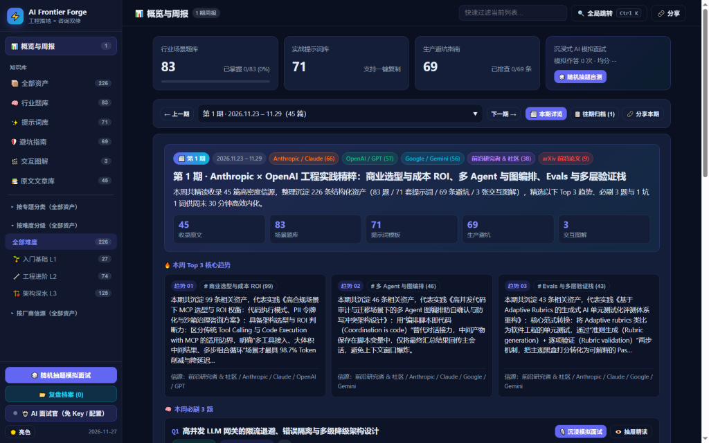
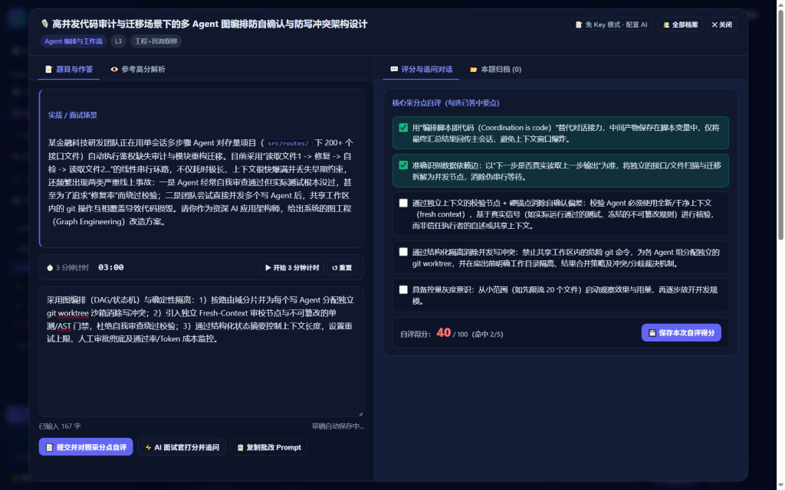
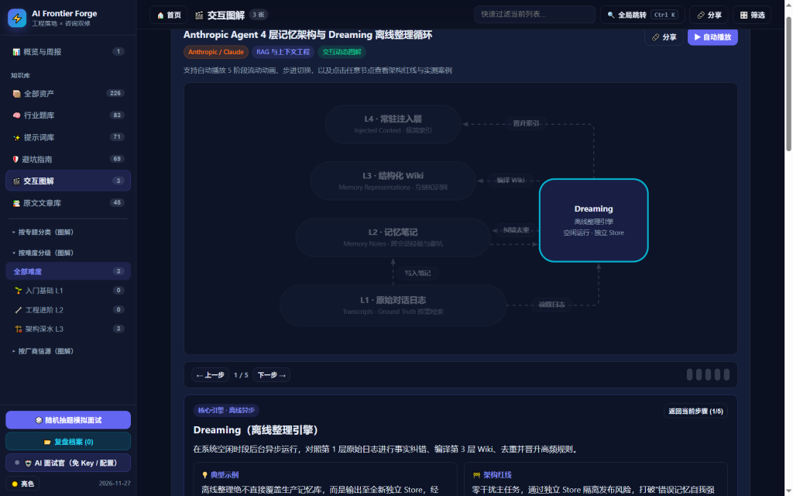

<div align="center">

# ⚡ AI Frontier Forge

**面向 AI 应用 / Agent 工程落地 × AI 解决方案咨询双修的前沿结构化知识库、每周精粹周报与沉浸式模拟面试训练台**

[](https://atcxigua.github.io/ai-frontier-forge/)
[](#知识库全景)
[](#知识库全景)
[](./LICENSE)
[](./LICENSE-DATA)

[立即在线体验](https://atcxigua.github.io/ai-frontier-forge/) · [核心亮点](#核心亮点特色) · [交互界面预览](#界面与功能预览) · [知识库全景](#知识库全景) · [本地运行](#本地运行方式) · [推荐一手好文](./CONTRIBUTING.md)

</div>

---

## 为什么做这个项目？

前沿 AI 工程实践散落在 Anthropic、OpenAI、Google 官方工程博客、交互课程与一线架构论文中，直接通读既耗时，又很难沉淀为面试与项目决策里的「可复用判断力」。

**AI Frontier Forge** 将这些高密度一手资料拆解为可直接刷题、直接抄模板、直接排障复盘的 **4 类结构化知识资产 + 每周精粹周报 + 零后端沉浸式模拟面试官**，全部以纯静态 Web 方式运行，桌面与手机浏览器打开即用。

---

## 核心亮点特色

- **🏔️ 三大厂全阶金字塔（L1 入门 → L2 工程进阶 → L3 架构深水）**：均衡覆盖 **Anthropic / OpenAI / Google** 一手官方课程、工程博客、前沿社区与 arXiv 论文；既包含 27 道官方教材提炼的 `L1` 入门基础与 API 场景题，也覆盖生产级多 Agent 编排、Evals、RAG 与商业 ROI 深水架构题。
- **🔗 100% 一手原文溯源**：每条题目、提示词、避坑与图解都附带原始出处链接（`source_url`）与关键原文依据摘录（`evidence_quote`），拒绝二手搬运与空泛八股。
- **🎙️ 零后端沉浸式双栏 AI 模拟面试官**：
  - **免 Key 开箱即用**：内置 3 分钟倒计时、核心采分点实时勾选计分、一键复制结构化批改模板给任意外部 AI 助手。
  - **可选 BYOK 深度追问**：本地配置任意 OpenAI 兼容接口（API Key 仅存当前浏览器 `localStorage`，零服务端中转），体验多轮高压追问与逐维评分。
  - **本地复盘档案库**：自动保存每次作答记录，支持导出 Markdown、打印 PDF 报告与全量 JSON 备份迁移。
- **🎬 动态交互式 SVG 架构图解**：复杂系统架构可视化为可自动播放、可步进切换、可点击任意节点查看设计取舍与红线的交互图解。
- **📱 桌面 + 手机双端原生级阅读体验**：
  - 桌面端支持 `Ctrl+K / ⌘K` 全局秒跳、专题/难度/厂商三级树联动、精准筛选弹窗与右侧滑出专注阅读抽屉。
  - 手机端采用无底部遮挡的随滚横向快捷胶囊条 + 顶栏 `🏠` 一键回首页 + 原生 Bottom Sheet 筛选器 + History 历史栈接管系统边缘右滑返回（逐层关闭抽屉/退回首页，绝不一滑误退出站），并支持纯净无黑边的**深色 / 亮色双主题**。
- **⭐ 本地收藏、个人笔记与深链直达**：支持单条收藏、个人心得自动保存（`localStorage`），以及任意条目/专题/周报一键复制带直达锚点的分享链接。

---

## 界面与功能预览

### 1. 概览仪表盘与每周前沿周报
按周沉淀 Top 3 技术趋势、必刷 3 题与精选避坑/提示词，配合左侧「专题 × 难度金字塔 × 厂商信源」多维检索与 `Ctrl+K / ⌘K` 全局秒跳，适合周末 30 分钟高效复盘。



### 2. 沉浸式双栏 AI 模拟面试训练台
左侧读场景、开 3 分钟倒计时作答并随时切看参考解析；右侧对照采分点实时打分（免 Key）或接入自带模型进行多轮追问批改，全量记录自动归档至本地档案库。



### 3. 动态交互式 SVG 架构图解
支持自动播放阶段流动动画、步进切换，以及点击任意架构节点展开设计红线与典型实测示例（覆盖 Agent 4 层记忆与离线整理循环、Harness 对比、企业级 RAG + Agent 生产降级闭环）。



### 4. 移动端清爽阅读与原生级防误退体验（亮色 / 深色双主题）
专为手机单手浏览打磨：单行紧凑顶栏（含 `🏠` 一键回首页）、文档流随滚横向快捷胶囊条（快速下滑零底部割裂）、全宽 Bottom Sheet 筛选器与浏览器边缘右滑逐层返回保护。

<p align="center">
  
</p>

---

## 知识库全景

当前已精读收录 **45 篇** 高密度一手官方教学资料、工程博客与前沿论文，提炼 **226 条** 可溯源结构化资产，持续增量更新：

| 资产形态 | 当前规模 | 核心结构与用途 | 数据文件 |
| :--- | :---: | :--- | :--- |
| **行业场景题库** | **83 题** | 难度金字塔 **L1 入门 27 · L2 进阶 32 · L3 架构 24**；覆盖工程落地 × 咨询方案双赛道，含实战场景、参考答案、采分点、连环追问与常见误区 | `data/questions.json` |
| **实战提示词库** | **71 套** | 含角色设定、可替换变量、反例对比与调优建议，支持一键带来源复制即用 | `data/prompts.json` |
| **生产避坑指南** | **69 条** | 按线上现象、底层根因、错误做法、架构级解法与确定性验收指标拆解 | `data/pitfalls.json` |
| **交互架构图解** | **3 张** | 自动播放 + 节点点击解析 + 典型量化示例的动态 SVG 架构图 | `data/diagrams.json` |
| **每周前沿周报** | **按周归档** | 单期焦点 + 往期归档 + 45 篇原文文章库，聚合每周核心趋势与必刷清单 | `data/digests.json` |

**信源分布与 6 大专题覆盖**：
- **信源阵营**：Anthropic / Claude（64）· OpenAI / GPT（57）· Google / Gemini（55）· 前沿研究者 & 社区（38）· arXiv 前沿论文（9）
- **六大专题**：Agent 编排与工作流（48）· 选型架构与咨询 ROI（48）· Eval 评测与可靠性（37）· Prompt 工程（37）· RAG 与上下文工程（34）· MCP 与工具集成（19）

---

## 本地运行方式

本仓库为纯静态站点（零构建依赖、零后端服务），前端通过 `fetch('./data/*.json')` 动态加载结构化数据。

> **注意**：由于浏览器安全策略限制，**请勿通过 `file://` 直接双击 `index.html` 打开**，需使用任意本地 HTTP 服务启动：

```bash
git clone https://github.com/atcXiGua/ai-frontier-forge.git
cd ai-frontier-forge
python -m http.server 8000
```

随后在浏览器访问 `http://127.0.0.1:8000/` 即可正常使用。

---

## 内容来源与版权说明

- **来源与引用原则**：本库每条知识资产均保留原始出处链接（`source_url`）与简短的原文依据摘录（`evidence_quote`），**不收录或分发第三方文章全文**。如需深入阅读，请点击对应条目中的原文链接访问原作者页面。
- **开源协议分层**：
  - **前端与工具代码**：采用 [MIT License](./LICENSE) 开源。
  - **整理后的结构化知识库数据（`data/*.json`）**：采用 [Creative Commons Attribution-NonCommercial 4.0 International (CC BY-NC 4.0)](./LICENSE-DATA) 协议授权——允许非商业场景下的署名共享与学习研究，禁止未经授权的商业搬运与售卖。

---

## 参与贡献与更多文档

- **推荐高价值一手资料**：欢迎通过 [内容投稿 Issue](./.github/ISSUE_TEMPLATE/content-submission.yml) 提交官方工程博客、论文实践或真实生产避坑案例，详情见 [CONTRIBUTING.md](./CONTRIBUTING.md)。
- **高层架构设计**：请参阅 [ARCHITECTURE.md](./ARCHITECTURE.md)。
- 如果这个刷题与演练站帮到了你的项目落地或面试准备，欢迎点亮右上角 **Star** 支持持续周更！
